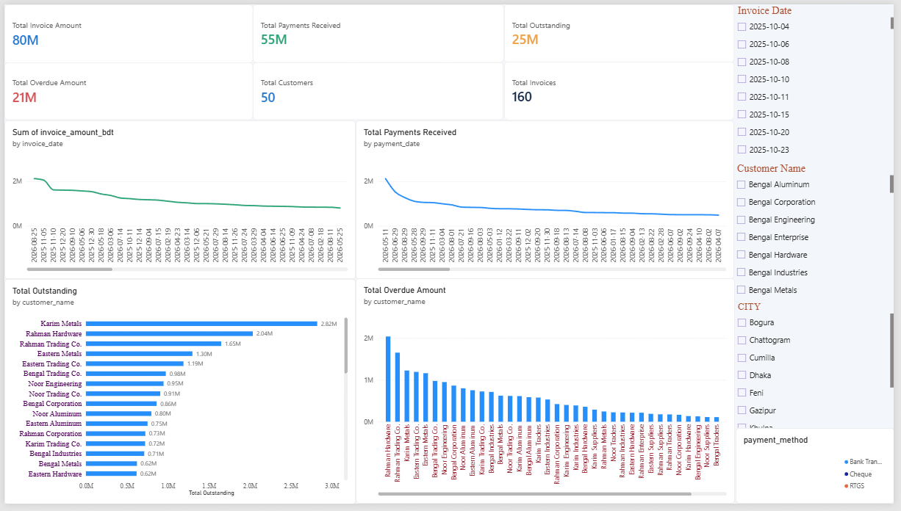

Smart-Business-Cash-Flow-Analytics

A Business Intelligence using Microsoft Excel, MySQL, and Power BI to analyze invoices, customer payments, outstanding balances, and overdue receivables.

Project Overview
This project analyzes fictional business transaction data from an aluminum trading business covering October 2025 to September 2026. The goal is to help management monitor cash flow, track customer payments, and identify overdue invoices through an interactive dashboard.

Tools & Technologies

Microsoft Excel
MySQL
Power BI
DAX

Key Performance Indicators

Total Invoice Amount       80M BDT
Total Payments Received    55M BDT
Total Outstanding          25M BDT
Total Overdue Amount       21M BDT
Total Customers            50
Total Invoices             160

Future Improvements

Machine Learning-based Payment Delay Prediction
Automated Data Entry System

## Dashboard Preview

Author- CSE Student 
